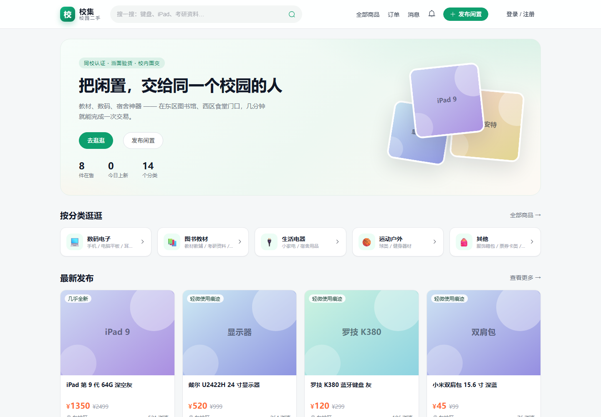
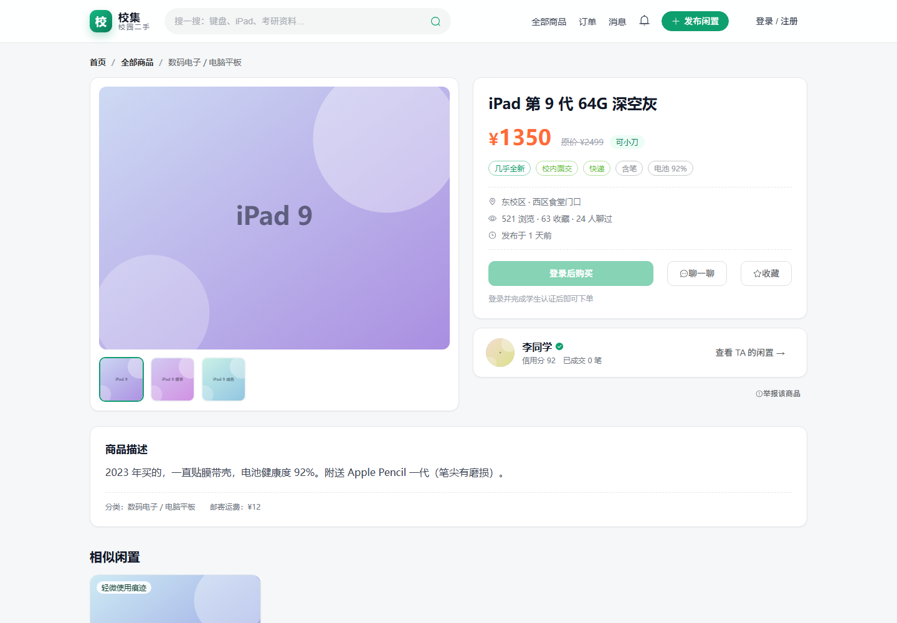

# 校集 · 校园二手交易平台

一个校内二手交易平台的完整项目：接口文档 + OpenAPI 规范 + Vue 3 前端（自带演示数据，无需后端即可运行）。



## 目录

| 目录 | 内容 |
|---|---|
| [`web/`](web/README.md) | Vue 3 + Vite + Element Plus 前端，内置 mock，可独立运行 |
| [`docs/校园二手交易平台接口文档.md`](docs/校园二手交易平台接口文档.md) | 接口文档：通用规范、14 个模块、错误码、状态机、数据模型 |
| [`docs/openapi.json`](docs/openapi.json) | OpenAPI 3.0 规范，供 Apifox / Swagger UI / Postman 导入 |
| [`docs/screenshots/`](docs/screenshots) | 页面截图 |
| [`scripts/`](scripts) | OpenAPI 生成与校验脚本 |

## 快速开始（前端）

```bash
cd web
npm install
npm run dev
```

打开 <http://localhost:5173>，用演示账号 `13800001234` / 任意密码登录（登录页也可一键体验）。

功能覆盖：浏览筛选、商品详情、发布闲置、下单支付、发货/确认收货、退款、评价、站内聊天、学生认证、我的商品/收藏/浏览历史、通知。

## 部署到虚拟机（Docker）

本地打包（产物在 `release/campus-web.tar.gz`，约 0.5 MB，已含构建好的 `dist/`）：

```bash
cd web && npm run build
# 然后用 scripts 里的打包步骤或直接上传 web/dist + web/nginx.conf
```

虚拟机侧（FinalShell）：

```bash
cd /opt && tar -xzf campus-web.tar.gz && cd campus-web
docker compose up -d --build
curl -I http://127.0.0.1:8080          # 200，Server: nginx
```

浏览器访问 `http://<虚拟机IP>:8080`。包内 `README.md` 有防火墙、更新流程、镜像加速、挂载部署等完整说明。

## 接口文档

- 人类阅读版：[docs/校园二手交易平台接口文档.md](docs/校园二手交易平台接口文档.md)
- 机器可读版：[docs/openapi.json](docs/openapi.json)

在 Apifox 中导入：项目设置 → 导入数据 → **OpenAPI / Swagger** → 选文件，或直接用 raw 地址：

```
https://raw.githubusercontent.com/spyderman-cn/test01/main/docs/openapi.json
```

修改接口后重新生成并校验：

```bash
node scripts/build-openapi.mjs
node scripts/validate-openapi.mjs
```

## 技术栈

**前端**：Vue 3（`<script setup>`）、Vue Router、Pinia、Element Plus、Axios、Vite
**演示数据**：浏览器 localStorage + axios 自定义 adapter，前端零后端依赖



## 说明

- 演示数据仅保存在本机浏览器，可随时在「个人中心 → 账号设置」重置。
- 前端接口层与接口文档一一对应，关闭 mock 并把 `VITE_API_BASE` 指向真实后端即可联调，详见 [web/README.md](web/README.md)。
- 项目为教学/演示用途，支付、实名认证等均为模拟实现。
