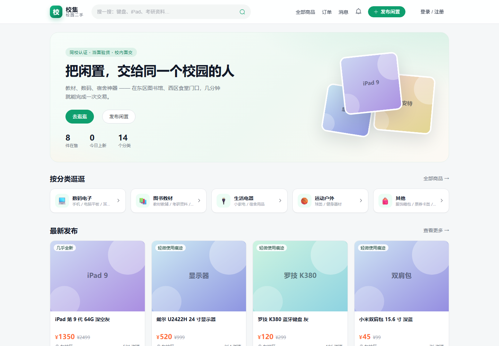
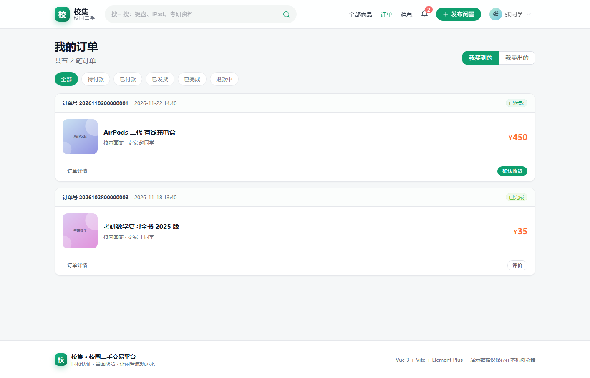

# 校集 · 前端（Vue 3）

校园二手交易平台前端。Vue 3 + Vite + Element Plus，内置演示数据，**不依赖后端即可完整跑通**：发布、下单、支付、聊天、评价全流程。



## 快速开始

```bash
cd web
npm install
npm run dev          # http://localhost:5173
```

其他命令：

```bash
npm run build        # 产物在 dist/
npm run preview      # 预览 dist/
```

> 演示账号：`13800001234` / 任意密码（登录页有「一键体验登录」）。

## 生产部署（nginx）

```bash
npm run build          # 产物在 dist/，约 1.7 MB
```

### 方式一：本机 nginx（Windows，已在本机跑通）

本机路径约定：nginx 解压到 `D:\nginx-web\nginx-1.27.4`，静态文件放 `D:\nginx-web\html`。

```powershell
# 1. 下载并解压 nginx for Windows（https://nginx.org/download/nginx-1.27.4.zip）
# 2. 把构建产物拷过去
Copy-Item dist\* D:\nginx-web\html -Recurse -Force
# 3. 用 web/nginx.conf 覆盖 conf\nginx.conf，注意 root 改成 D:/nginx-web/html
# 4. 启动 / 重载 / 停止
D:\nginx-web\nginx-1.27.4\nginx.exe -p D:/nginx-web/nginx-1.27.4/ -c conf/nginx.conf
D:\nginx-web\nginx-1.27.4\nginx.exe -p D:/nginx-web/nginx-1.27.4/ -c conf/nginx.conf -s reload
D:\nginx-web\nginx-1.27.4\nginx.exe -p D:/nginx-web/nginx-1.27.4/ -c conf/nginx.conf -s stop
```

访问 <http://localhost:8080>，`/healthz` 返回 `ok`。改前端后重新 `npm run build` + 覆盖 `html` + `-s reload` 即可。

### 方式二：Docker

```bash
docker build -t campus-market-web .
docker run -d -p 8080:80 --name campus-market-web campus-market-web
# 或者
docker compose up -d --build
```

镜像为多阶段构建：Node 打包 → `nginx:alpine` 托管，配置见 [`Dockerfile`](Dockerfile) 与 [`docker-compose.yml`](docker-compose.yml)。

### 方式三：Linux 服务器

`dist/` 上传到 `/usr/share/nginx/html`，[`nginx.conf`](nginx.conf) 放到 `/etc/nginx/conf.d/campus-market.conf`，`nginx -t && systemctl reload nginx`。

> 已配置：gzip、`/assets/` 一年强缓存、`index.html` 不缓存、SPA 回退、`/v1` 反向代理模板、`/healthz`。
> 路由是 **hash 模式**（`/#/products`），不依赖服务端重写；若以后改 history 模式，`try_files $uri $uri/ /index.html` 已兜住。
> 开发用 `npm run dev`（Vite，热更新），部署用 nginx 托管 `dist/`，两者不冲突。

## 功能

| 模块 | 内容 |
|---|---|
| 首页 | 搜索、分类入口、最新发布、校内热门、信任保障 |
| 商品列表 | 关键词 + 分类 + 校区 + 价格区间 + 成色 + 交易方式筛选，四种排序，分页 |
| 商品详情 | 多图预览、成色/标签、卖家名片、收藏、聊一聊、举报、相似推荐 |
| 发布闲置 | 图片上传（最多 9 张）、成色/交易方式、面交地点、标签自定义、表单校验 |
| 订单 | 买家/卖家双视角、状态筛选、支付、取消、发货、确认收货、退款、评价 |
| 聊天 | 会话列表、消息气泡、Enter 发送、4 秒轮询、自动已读 |
| 个人中心 | 头像/资料编辑、学生认证、我的商品（下架/上架/删除）、收藏、浏览历史 |
| 通知 | 类型筛选、未读标记、点击跳转对应订单/商品 |

订单详情带进度条与状态时间线；未登录访问受保护页面会自动跳转登录并回跳原地址。

## 技术要点

- **Vue 3 `<script setup>` + Composition API**，状态用 Pinia（`user`、`catalog`）。
- **路由**：`vue-router` hash 模式（静态部署无需服务端重写），`meta.auth` 做登录守卫。
- **请求层**：`axios` 实例 + 统一响应处理，`code !== 0` 抛 `ApiError`，`401` 系列触发全局登出事件。
- **Mock**：自定义 axios adapter 拦截全部请求，数据存 `localStorage`，刷新不丢；「个人中心 → 重置演示数据」可恢复初始状态。
- **主题**：覆盖 Element Plus CSS 变量（主色 `#0e9f6e`），卡片化布局，适配 1080 / 760 断点。
- **图片**：演示数据用 SVG Data URI 生成封面与头像，完全离线可用。

## 目录结构

```
web/
├── index.html
├── vite.config.js
└── src/
    ├── api/            # http 实例 + 按模块拆分的接口（与接口文档一一对应）
    ├── components/     # ProductCard / OrderActions / StatusTag / EmptyBox
    ├── layout/         # AppLayout：头部导航、搜索、通知角标、页脚
    ├── mock/           # 演示数据（db.js）与 axios adapter（index.js）
    ├── router/         # 路由与登录守卫
    ├── stores/         # user、catalog
    ├── styles/         # 全局样式与主题变量
    ├── utils/          # 枚举字典、金额/时间格式化、占位图生成
    └── views/          # 9 个页面
```

## 对接真实后端

1. 复制 `.env.development` 为 `.env.local`，把 `VITE_USE_MOCK` 改为 `false`；
2. 打开 `vite.config.js` 里 `server.proxy` 的注释，把 target 换成后端地址；
3. 接口路径与 [`docs/校园二手交易平台接口文档.md`](../docs/校园二手交易平台接口文档.md) 完全一致，`src/api/*.js` 无需改动。

## 已剔除的演示逻辑

生产接入时需替换的两处「假实现」：

- `src/mock/**`：整目录可删；
- `src/api/upload.js`：mock 下用 `FileReader` 转 Data URL，真实环境走 `POST /files/images`。


